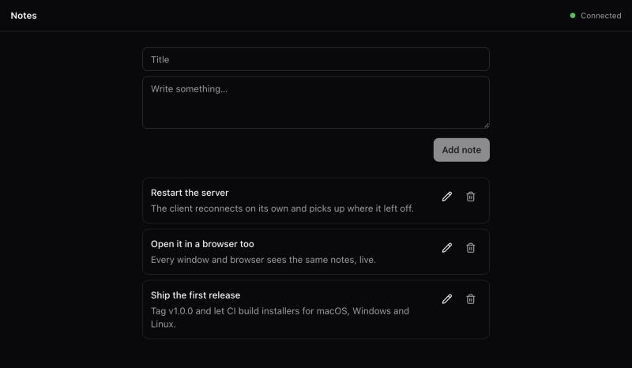

# Electron Effect Starter

A desktop app starter built on [Effect](https://effect.website) v4, with the architecture of a real product instead of a hello-world window.

<p align="center">
  
</p>

An Electron shell runs and supervises a local Effect server. One React app talks to that server over typed WebSocket RPC, in the desktop window and in any browser on your machine. The design follows the desktop app of [T3 Code](https://github.com/pingdotgg/t3code).

## Why start here

- **One app, two places.** The same build runs in the desktop window and in a browser, with live updates in both.
- **It recovers on its own.** A crashed server restarts with backoff. Clients reconnect after a restart or a laptop sleep. Quitting waits for the server to shut down cleanly.
- **Locked down by default.** The renderer is sandboxed behind a strict CSP, IPC is checked against schemas, and every client signs in, browsers included.
- **Effect from end to end.** The server, the shell and the client share typed errors, services and layers. The Effect source is vendored in the repo, so coding agents write idiomatic Effect.
- **Ready to ship.** Tagging a release builds installers for macOS, Windows and Linux, and installed apps update themselves from GitHub Releases.

The sample feature, a notes list that syncs across every window and browser, shows the full path from SQLite to the UI.

Built with Effect 4, Electron 45, React 19, TypeScript 7, Vite, Tailwind CSS 4, Turborepo, Vitest and oxlint.

## Get started

You need [pnpm](https://pnpm.io). It installs the right Node version for you.

```bash
npx degit AdiRishi/electron-effect-starter my-app
cd my-app
pnpm install
pnpm dev:desktop
```

To run it in a browser instead, use `pnpm dev` and open the sign-in link the server prints.

<details>
<summary>Make it yours</summary>

The name appears as `electron-effect-starter`, `Electron Effect Starter` and the app ID `com.example.electron-effect-starter`. Replace all three before you install:

```bash
grep -rlI --exclude-dir=repos -e electron-effect-starter -e "Electron Effect Starter" . | xargs sed -i '' -e 's/com\.example\.electron-effect-starter/com.acme.my-app/g' -e 's/electron-effect-starter/my-app/g' -e 's/Electron Effect Starter/My App/g'
```

On Linux, use `sed -i` without the empty string.

</details>
